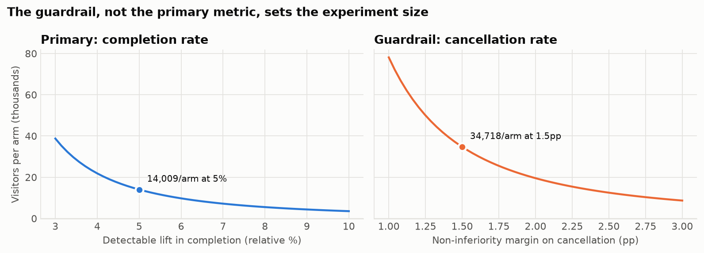
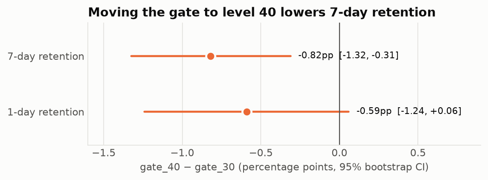
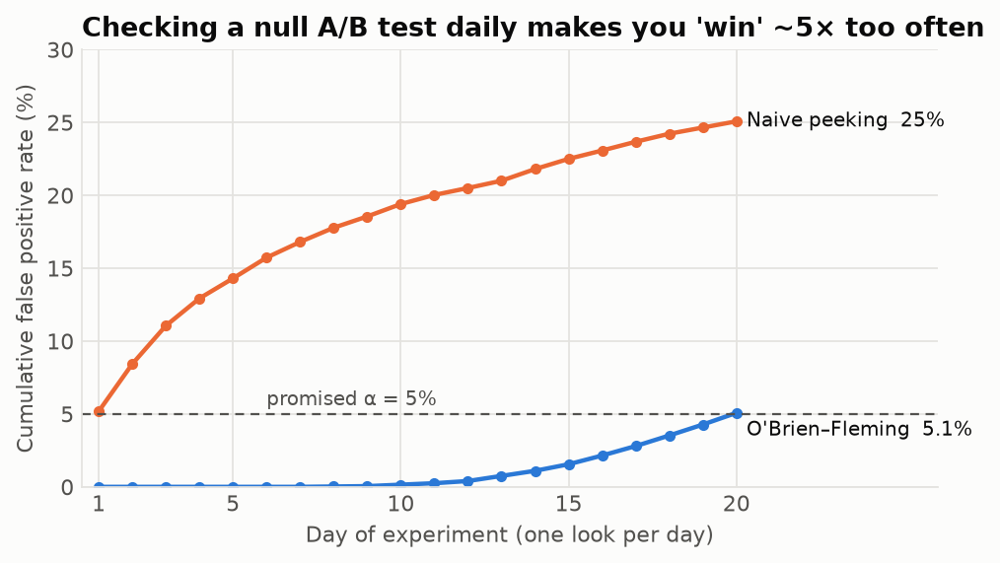
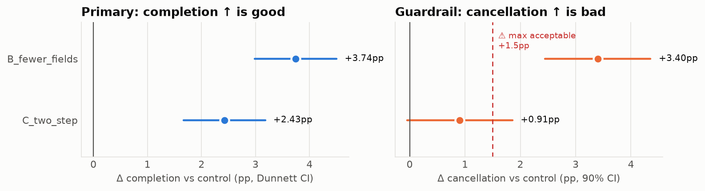
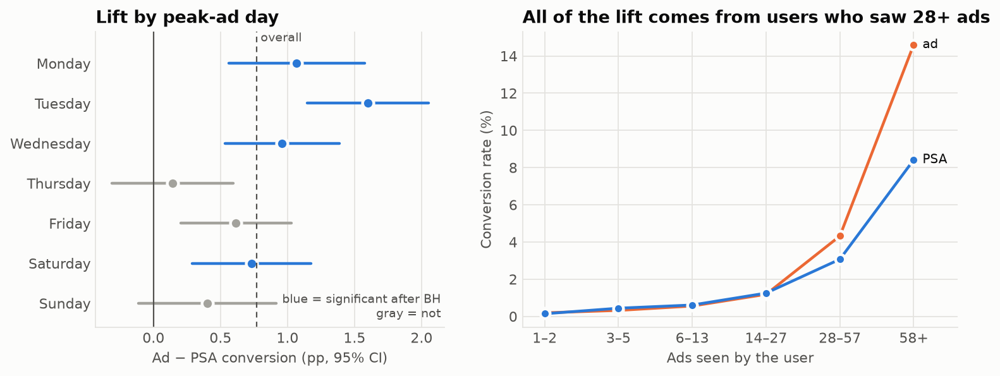
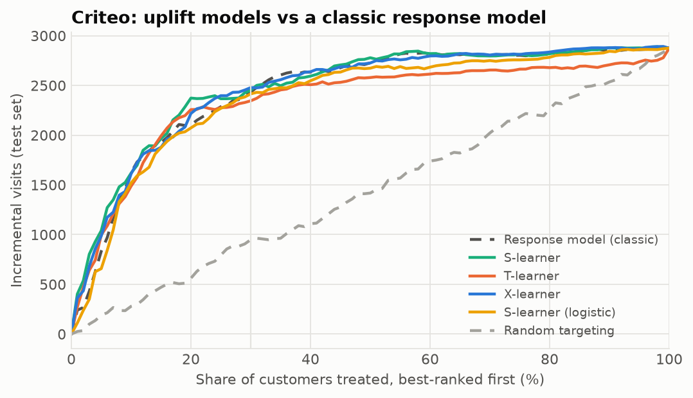

<h1 align="center">Experimentation Lab</h1>

<p align="center">
  <b>Design, analyse and stress-test online experiments, from the first sample-size calculation to the ship decision.</b>
</p>

<p align="center">
  <a href="#results-at-a-glance">Results</a> &nbsp;·&nbsp;
  <a href="#case-studies">Case studies</a> &nbsp;·&nbsp;
  <a href="#the-abkit-toolkit">Toolkit</a> &nbsp;·&nbsp;
  <a href="#interactive-app">App</a> &nbsp;·&nbsp;
  <a href="#run-it-yourself">Run it</a> &nbsp;·&nbsp;
  <a href="#data">Data</a>
</p>

<br>

<p align="center">
  
</p>

<br>

Most A/B testing tutorials stop at a p-value. This project covers the full workflow:

* **Trust the data:** sample-ratio checks and covariate balance.
* **Size the test:** power, minimum detectable effect and guardrails.
* **Analyse it:** frequentist and Bayesian methods, variance reduction, sequential looks
  and multiple-testing control.
* **Find who responds:** uplift modelling.
* **Make the decision:** pre-registered rules for shipping, holding or killing a variant.

Everything runs on **free tools and public data. No API keys, no paid services.** Every
statistical function is unit-tested against an independent reference.

<br>

## Results at a glance

<table>
  <tr>
    <td align="center" width="25%"><h2>−0.82pp</h2>7-day retention lost by moving the Cookie Cats gate to level 40</td>
    <td align="center" width="25%"><h2>24%</h2>false positive rate from daily peeking, vs. the 5% promised</td>
    <td align="center" width="25%"><h2>2.5×</h2>more users needed once the cancellation guardrail is powered</td>
    <td align="center" width="25%"><h2>86%</h2>of incremental Criteo visits captured by treating the top 30% of users</td>
  </tr>
</table>

| Study | Data | Finding |
|:--|:--|:--|
| Mobile-game gate test | 90,189 players | Gate 40 lowers 7-day retention from 19.02% to 18.20% (95% bootstrap CI −1.32 to −0.31pp; P(gate 40 better) = 0.07%). **Keep gate 30.** |
| Method calibration | 10,000 simulated A/A tests | False positive rate 5.2%; p-values uniform |
| Peeking | 20 daily looks × 4,000 runs | Naive peeking: 24% false positives. O'Brien–Fleming boundaries: ≤ 5% |
| Variance reduction | Simulated pre-period data | CUPED cuts variance by 58%, and the required sample size with it |
| Booking-form design | 97,576 real hotel bookings | The guardrail sets the size (34.7k vs. 14.0k per arm). A primary-only design would have shipped a variant that raises cancellations by 3pp |
| Design rehearsal | 300 simulated experiments | The harmful variant was never shipped; the safe variant shipped in 84% of runs |
| Ad campaign | 588,101 users | +43% conversion, about 4,300 incremental conversions. All of the lift comes from users who saw 28+ ads |
| Uplift, Criteo | 1M of 14M users | Targeting by an X-learner buys 2.9× more incremental visits per user treated |
| Uplift, Hillstrom | 64,000 customers | No model reliably beats random targeting. **E-mail everyone** |

<br>

## Case studies

### 01 &nbsp; Auditing a real experiment: Cookie Cats

<table>
  <tr>
    <td width="55%"></td>
    <td width="45%">
      A puzzle game moved its first progress gate from level 30 to level 40. The audit
      runs in a fixed order: trust, power, test, estimate, decide.
      <br><br>
      <b>Trust:</b> no duplicates; a borderline split imbalance (p = 0.009) is noted but
      doesn't change the result; one bot-like outlier with 49,854 rounds is removed.<br>
      <b>Power:</b> the test could detect a 0.74pp change with 80% power.<br>
      <b>Evidence:</b> z-test, Holm correction, a 10,000-resample bootstrap and a
      Beta–Binomial posterior all agree.
    </td>
  </tr>
</table>

&rarr; [`notebooks/01_cookie_cats_audit.ipynb`](notebooks/01_cookie_cats_audit.ipynb)

### 02 &nbsp; Do the methods keep their promises?

<table>
  <tr>
    <td width="55%"></td>
    <td width="45%">
      Simulations check the toolkit before trusting it with real decisions.
      <br><br>
      <b>A/A tests:</b> 10,000 experiments with no effect produce a 5.2% false positive rate.<br>
      <b>Peeking:</b> stopping on the first daily p &lt; 0.05 inflates errors almost
      five-fold. O'Brien–Fleming boundaries and mSPRT restore control.<br>
      <b>CUPED:</b> the estimate stays unbiased, with a 35% smaller spread.
    </td>
  </tr>
</table>

&rarr; [`notebooks/02_simulations.ipynb`](notebooks/02_simulations.ipynb)

### 03 &nbsp; Designing a booking-form experiment before launch

<table>
  <tr>
    <td width="55%"></td>
    <td width="45%">
      Two variants, fewer fields and a two-step form, are tested against a 12-field form.
      Removing the phone field may lift completion but hurt lead quality.
      <br><br>
      The design uses Dunnett-corrected comparisons, a cancellation non-inferiority
      guardrail, weekly O'Brien–Fleming looks, CUPED and hash-based assignment. It is then
      <b>rehearsed 300 times</b> in a simulator calibrated on real bookings.
    </td>
  </tr>
</table>

&rarr; [`notebooks/03_booking_form_design.ipynb`](notebooks/03_booking_form_design.ipynb) &nbsp;·&nbsp; [`docs/preregistration_booking_form.md`](docs/preregistration_booking_form.md)

### 04 &nbsp; Segments and the multiple-testing trap

<table>
  <tr>
    <td width="55%"></td>
    <td width="45%">
      A 96/4 ad-vs-PSA campaign with 588k users.
      <br><br>
      <b>Allocation:</b> the small holdout gives up only about 180 conversions, at the cost
      of a 2.3× wider confidence interval.<br>
      <b>Confounding:</b> the arms saw ads on different days. Cochran–Mantel–Haenszel
      adjustment leaves the effect unchanged (odds ratio 1.44).<br>
      <b>Segments:</b> 8 of 24 "winning hours" fall to 1 after Benjamini–Hochberg correction.
    </td>
  </tr>
</table>

&rarr; [`notebooks/04_marketing_segments.ipynb`](notebooks/04_marketing_segments.ipynb)

### 05 &nbsp; Uplift modelling: who should be treated?

<table>
  <tr>
    <td width="55%"></td>
    <td width="45%">
      S-, T- and X-learners are compared with a classic response model on two randomised
      datasets.
      <br><br>
      <b>Criteo:</b> strong heterogeneity. Treating the top 30% of users captures 86% of
      incremental visits.<br>
      <b>Hillstrom:</b> weak heterogeneity. Flexible models overfit it, which a 5-split
      robustness check exposes. The honest answer is to treat everyone.
    </td>
  </tr>
</table>

&rarr; [`notebooks/05_uplift_modeling.ipynb`](notebooks/05_uplift_modeling.ipynb)

<br>

## The `abkit` toolkit

A small, dependency-light library behind every analysis, with 27 tests. Each function is
checked against an independent reference: statsmodels, SciPy, published statistical
tables, or simulated data with a known answer.

| Module | What it does | Verified against |
|:--|:--|:--|
| `power` | Sample size, power and MDE for proportions and means, with unequal splits | Fleiss tables |
| `tests` | Two-proportion z-test, Welch's t-test, Mann–Whitney, Wilson intervals, chunked bootstrap | statsmodels, SciPy |
| `srm` | Sample-ratio-mismatch detection | Known balanced and unbalanced splits |
| `assignment` | Sticky, salted SHA-256 bucketing, the way production SDKs assign users | Uniformity and independence tests |
| `variance` | CUPED, delta method for ratio metrics | Theoretical variance reduction, bootstrap |
| `sequential` | O'Brien–Fleming boundaries by exact recursive integration, mSPRT | gsDesign / ldbounds (to 4 decimals) |
| `bayes` | Beta–Binomial: P(B > A), expected loss, credible intervals | Symmetry and direction checks |
| `multiple` | Holm, Benjamini–Hochberg, Dunnett critical values | statsmodels, published Dunnett tables |
| `uplift` | S-, T- and X-learners, Qini curve and coefficient, uplift@k | Simulated data with known effects |

<details>
<summary><b>Repository layout</b></summary>

```
abkit/                     statistics toolkit (above)
labsim/booking.py          booking-funnel simulator and the pre-registered analysis
notebooks/                 five case studies, stored as .py (jupytext) with executed .ipynb
docs/                      experiment pre-registration
app/streamlit_app.py       interactive app
scripts/fetch_data.py      downloads all public data and builds a local DuckDB database
reports/                   figures and machine-readable results (JSON)
tests/                     unit tests
.github/workflows/ci.yml   tests, data download and full notebook re-execution on every push
```

</details>

<br>

## Interactive app

A Streamlit app with three tools:

* **Sample size:** users per arm and test duration for any baseline, effect size and
  number of variants (Dunnett-adjusted).
* **Analyse a test:** paste counts or upload a CSV. You get an SRM check, a significance
  test, confidence intervals, the probability each arm is better, and expected loss.
* **Peeking simulator:** watch false positives accumulate as you check results daily.

```bash
streamlit run app/streamlit_app.py
```

The app needs no data download. To host it for free, connect this repository on
Streamlit Community Cloud and set the main file to `app/streamlit_app.py`.

<br>

## Run it yourself

```bash
git clone https://github.com/DGskywalker/experimentation-lab.git
cd experimentation-lab
python -m venv .venv && source .venv/bin/activate
pip install -r requirements.txt && pip install -e .

pytest -q                        # 27 tests
python scripts/fetch_data.py     # downloads all datasets (Criteo is 311 MB) into data/lab.duckdb
cd notebooks && for nb in 0*.py; do jupytext --to ipynb --execute "$nb"; done
```

Notebooks are stored as plain Python files (jupytext percent format), so code review
stays readable. Executing them regenerates every figure and result file in `reports/`.

<br>

## Data

| Dataset | Size | Source |
|:--|:--|:--|
| Cookie Cats | 90,189 players | Tactile Entertainment via DataCamp / Kaggle |
| Hotel Booking Demand | 119,390 bookings | Antonio, Almeida &amp; Nunes, *Data in Brief* (2019), via TidyTuesday |
| Marketing A/B Testing | 588,101 users | Kaggle |
| MineThatData E-Mail Analytics | 64,000 customers | Kevin Hillstrom (2008) |
| Criteo Uplift v2.1 | 13,979,592 users (1M-row sample used) | Diemert et al. (2018), Criteo on Hugging Face |

All data is downloaded by `scripts/fetch_data.py`; none is stored in this repository.

<br>

## Honest limits

* The booking-form completion rate (35%) and traffic (4,000 form starts a day) are
  assumptions. The hotel data has no funnel, so only cancellation rates and booking
  values come from real records.
* In the ad campaign, ad exposure and peak-ad day describe users, not randomised
  conditions. The segment findings are leads for follow-up experiments, not causal claims.
* CUPED gives only about 5% variance reduction in the booking simulation, because
  pre-period visits are a weak predictor of a 0/1 outcome. This is reported as found.

<br>

<p align="center">
  <sub>Built with Python, DuckDB, SciPy, statsmodels, scikit-learn, matplotlib and Streamlit.</sub>
</p>
